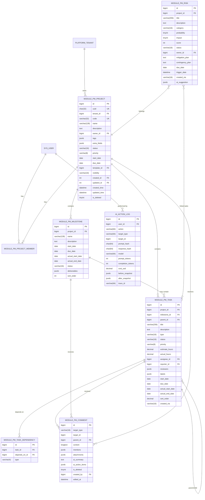

# 产品需求文档（PRD）：AI 增强企业级项目管理系统

> **基于 AiAdmin 二次开发** — 覆盖项目 / 里程碑 / 任务 / 进度 / 风险 / 评论 6 大模块，集成 AI 能力。
>
> **v2 相对 v1 的主要修订**：① 架构决策与状态机表化 ② 与 AiAdmin 框架口径对齐 ③ 每个 AI 能力补评测口径与降级路径 ④ Open Questions 给出推荐 ⑤ 附录 M 任务清单独立成 plan 文件。
> **读者画像**：研发负责人（架构 / 数据建模 / 状态机 / 可观测 / 验收口径为主）。

---

## 0. 文档信息

| 项 | 内容 |
|---|---|
| 文档版本 | **v2.0**（覆盖 v1.0；v1 见 git 历史） |
| 创建日期 | 2026-06-30 |
| 修订日期 | 2026-06-30 |
| 作者 | 产品 + 技术调研团队 |
| 状态 | 待评审（Draft） |
| 主读者 | **研发负责人**（架构决策 / 数据建模 / 状态机 / 验收口径） |
| 次读者 | 测试负责人 / PMO / 安全合规代表 |
| 关联文档 | 《AiAdmin CLAUDE.md》《AiAdmin DATABASE.md》《AI PM 最佳实践调研报告》 |
| 关联规范 | `docs/superpowers/specs/`、`docs/superpowers/plans/` |
| 目标里程碑 | M1（8 周）→ M2（8 周）→ M3（8 周），总周期 6 个月 |

---

## 1. 概览

### 1.1 一句话定位

> 在 AiAdmin 之上构建**企业级 AI 增强项目管理系统**，覆盖项目全生命周期，**让 PM 团队从"事务协调者"升级为"洞察决策者"**。

### 1.2 业务背景（压缩）

| 现状 | 本期目标 |
|---|---|
| Jira + 飞书项目 + 自研小工具，数据散落 | 单一事实源（SSOT） |
| AI 能力碎片（妙记/闪记/Notion AI 各管一段） | 统一 AI 对话入口（项目助理） |
| 模板复用弱，每个部门从 0 搭 | 5 个内置范式模板 + 自服务字段扩展 |
| 海外 AI 合规不可用 | 双轨：国内（Qwen3 / DeepSeek 默认）+ 海外（Anthropic / OpenAI 备选） |

### 1.3 OKR / North Star（M3 收官目标）

| 维度 | 指标 | 目标值 | 测量方法 |
|---|---|---|---|
| **采用** | 月活 PM 数 / 内部月活目标用户占比 | ≥ 60% | 后台埋点 `module_pm_active_users` |
| **效率** | PM 平均创建任务耗时 | 5 min → 30 s（用 NL 建任务） | `nl_to_task` 端到端埋点 |
| **预测** | 进度预测 MAPE（里程碑达成日） | ≤ 25% | 离线评测集（30 个相似项目留一） |
| **风险** | 风险被自动识别并被 PM 处理的比率 | ≥ 70% | `risk_accepted / risk_suggested` 比率 |
| **AI 体验** | 用户对 AI 回答的"采纳率" | ≥ 55% | 助手面板 feedback 按钮埋点 |
| **模板** | 模板可复用项目占比（新项目基于模板创建） | ≥ 40% | `template_id IS NOT NULL / NEW` 比率 |
| **自服务** | 启用模板/字段扩展不需要研发介入的比率 | ≥ 80% | 季度抽样调查 |

> 评测方法的可执行定义见 §7.5「AI 评测流水线」。

### 1.4 范围与不在范围

**v1 范围（3 个里程碑全部覆盖）**：项目管理、里程碑管理、任务管理、进度管理、风险管理、评论管理、AI 项目助理、会议纪要。

**v1 不在范围（Out of Scope）**：

| 项 | 推迟到 |
|---|---|
| 计费 / 付费 / Billing | v2 |
| 多租户 SaaS 化 | v2（v1 单租户，借 AiAdmin `platform_tenant` 单租） |
| 外部客户 / 干系人门户 | v2 |
| 自定义工作流 / 状态机引擎 | v2（v1 仅内置固定状态机） |
| 看板画板 / 白板协同 | v2 |
| 移动 App | v2（先做响应式 Web） |
| 工时管理 / Timesheet 复杂审批 | v2 |
| 与外部 IM/邮件的双向深度集成 | v2（v1 仅单向通知） |

---

## 2. 架构总览与技术选型

### 2.1 系统组件图

```
┌─────────────────────────────────────────────────────────────────┐
│  Frontend (Web: Vue3 + Element Plus)                             │
│  ┌──────────┐  ┌──────────┐  ┌──────────┐  ┌──────────────┐    │
│  │ 项目/任务 │  │ 看板/甘特│  │ AI 助手面板│  │  PMO 仪表盘 │    │
│  └────┬─────┘  └────┬─────┘  └────┬─────┘  └──────┬───────┘    │
└───────┼──────────────┼──────────────┼───────────────┼────────────┘
        │              │              │               │
        ▼              ▼              ▼               ▼
┌─────────────────────────────────────────────────────────────────┐
│  Backend (FastAPI 0.115 + async)                                 │
│  ┌────────────────────────────────────────────────────────┐     │
│  │ API Layer (module_pm_*)                                │     │
│  │  OperationLogRoute + AuthPermission(<m>:<c>:<a>)        │     │
│  └────────────────────────────────────────────────────────┘     │
│  ┌─────────────┐ ┌─────────────┐ ┌──────────────┐ ┌──────────┐ │
│  │ Domain Svc  │ │ AI Service  │ │ Predict Svc  │ │  Audit   │ │
│  │  (per-mod)  │ │  (LLM/工具) │ │  (CPM/RAG)   │ │  (loguru)│ │
│  └──────┬──────┘ └──────┬──────┘ └──────┬───────┘ └────┬─────┘ │
│         │               │               │              │       │
│  ┌──────▼───────────────▼───────────────▼──────────────▼─────┐ │
│  │ Core (FastapiAdmin): DB / Redis / Security / Permission  │ │
│  └──────────────────────────────────────────────────────────┘ │
└─────────────────────────────────────────────────────────────────┘
        │              │               │              │
        ▼              ▼               ▼              ▼
┌────────────┐  ┌────────────┐  ┌────────────┐  ┌────────────┐
│  MySQL 8   │  │  Redis 7   │  │ pgvector   │  │ LLM Prov. │
│  (SSOT)    │  │ (cache/    │  │ (RAG)      │  │ (LiteLLM)  │
│            │  │  session/  │  │            │  │  Qwen/DS   │
│            │  │  rate-lim) │  │            │  │  Anth./GP  │
└────────────┘  └────────────┘  └────────────┘  └────────────┘
```

### 2.2 技术选型矩阵

> 标注约定：**推荐 = 强烈建议**；**备选 = 评审可决**；**否决 = 已知问题排除**。

| 类别 | 选型 | 状态 | 理由 / 风险 |
|---|---|---|---|
| 后端框架 | FastAPI 0.115+ async | ✅ 推荐 | 框架已锁定（AiAdmin） |
| ORM | SQLAlchemy 2.0 async + Alembic | ✅ 推荐 | 框架已锁定 |
| 主数据库 | MySQL 8.0+ | ✅ 推荐 | AiAdmin 默认；JSON 字段用 jsonb 兼容层 |
| 缓存 / Session | Redis 7 | ✅ 推荐 | 框架已锁定 |
| **LLM 抽象** | **LiteLLM** | ✅ 推荐 | 一行切 Provider；社区主流 |
| **默认国内 LLM** | **Qwen3-Plus / DeepSeek-V3** | ✅ 推荐 | 合规可用；价格低 |
| **海外 LLM 备选** | **Anthropic Sonnet 4.5（拆任务）/ GPT-4o-mini（成本）** | ✅ 推荐 | 结构化输出强；成本敏感用 mini |
| **意图分类模型** | **Haiku 4.5 / GPT-4o-mini** | ✅ 推荐 | 速度优先；本地小模型 v2 评估 |
| **向量库** | **pgvector** | ✅ 推荐 | 与 PG 同库，运维简单；够用 |
| **Embedding 模型** | **bge-m3 / text-embedding-3-small** | 🟡 备选 | 中文为主 bge-m3；多语种 text-embedding-3-small |
| **任务队列** | **APScheduler (v1) → Celery + Redis (v1.1)** | ✅ 推荐 | M1/M2 APScheduler 够；M3 切 Celery 解决多实例重复执行 |
| **工作流引擎** | **Temporal** | ❌ v2 | v1 内置状态机足够，避免引入 |
| **日志 / 追踪** | **loguru + OpenTelemetry** | ✅ 推荐 | 框架已锁 loguru |
| **指标** | **Prometheus + Grafana** | ✅ 推荐 | 框架已暴露 `/api/v1/common/metrics` |
| **API 文档** | **Swagger UI + Redoc** | ✅ 推荐 | FastAPI 内置 |
| **定时任务** | APScheduler 3.11+（v1）→ Celery beat（v1.1） | ✅ 推荐 | 同上 |
| **测试** | pytest + pytest-asyncio + SQLite + fakeredis | ✅ 推荐 | 框架约定 |
| **E2E** | Playwright | ✅ 推荐 | 框架约定 |
| **前端构建** | Vite 7 + TypeScript 严格 | ✅ 推荐 | 框架已锁定 |
| **样式** | Tailwind 4 + SCSS（Web）/ UnoCSS（移动端 v2） | ✅ 推荐 | 框架约定 |
| **部署** | Docker Compose (mysql/redis/backend/nginx) | ✅ 推荐 | `./deploy.sh` 一键 |

### 2.3 AI 调用分层架构

```
用户输入 (NL)
   │
   ▼
┌──────────────────┐
│ ① 路由层          │  ← 意图分类 (Haiku/mini) → 选下游 Pipeline
└──────┬───────────┘
       ▼
┌──────────────────┐
│ ② 编排层          │  ← 工具调用：拉任务/项目/进度/风险
│   (Orchestrator) │     RAG 检索：pgvector 找相似项目/历史
└──────┬───────────┘     状态查询：MySQL (经 RBAC 过滤)
       ▼
┌──────────────────┐
│ ③ 模型层          │  ← LiteLLM 切换 Provider
│   (LLM Gen)      │     JSON schema 强制结构化输出
└──────┬───────────┘     Prompt 缓存 (Redis, TTL 24h)
       ▼
┌──────────────────┐
│ ④ 审计层          │  ← 写 ai_action_log (append-only, 90 天)
└──────────────────┘     脱敏 PII (regex + NER)
                         输出引用卡片 (点回原始对象)
```

### 2.4 跨切关注点

| 关注点 | 实现位置 |
|---|---|
| **日志** | `app/core/logger.py`（loguru）+ ELK；每个 AI 调用带 `trace_id` |
| **限速** | Redis token-bucket；用户级 QPS + 租户级日 token cap |
| **配额** | `ai_quota` 表 + Redis 计数；超出走降级 |
| **降级** | 见 §7.6「降级与回退」 |
| **审计** | ① 业务操作日志：复用 `OperationLogRoute` ② AI 操作日志：`ai_action_log` 独立表（90 天） |
| **可观测** | ① `/api/v1/common/metrics` 暴露 Prometheus 指标 ② OpenTelemetry trace ③ Grafana PMO 看板 |

---

## 3. 状态机与不变量

> **原则**：状态机用**迁移表**而非 ASCII 图，便于 code-review、单元测试、Alembic 校验。

### 3.1 Project 状态迁移

| from | event | guard | to | side-effect |
|---|---|---|---|---|
| (any new) | create | code unique; owner ∈ valid users | `planning` | 写 audit |
| `planning` | activate | due_date ≥ today | `active` | 触发"启动进度计算" |
| `active` | put_on_hold | reason required | `on_hold` | 暂停 cron 预测 |
| `on_hold` | resume | — | `active` | 重启 cron 预测 |
| `active` | complete | all milestones `done` or `cancelled`; all tasks not in `in_progress` | `completed` | 触发归档评估 |
| `active` | cancel | reason required; PMO confirm | `cancelled` | 触发归档 |
| `completed` | archive | PMO confirm | `archived` | 冻结向量库 |

### 3.2 Milestone 状态迁移

| from | event | guard | to | side-effect |
|---|---|---|---|---|
| (any new) | create | `due_date` ∈ project 区间 | `upcoming` | — |
| `upcoming` | start | `start_date` ≤ today | `in_progress` | 写 audit |
| `in_progress` | complete | 所有关联 task 全部 `done`/`cancelled` | `done` | 触发进度重算 |
| `in_progress` | cron tick | `today > due_date + grace(3d)` | `at_risk` | 通知 PM + 风险预警 |
| `at_risk` | cron tick | `today > due_date + 14d` | `missed` | 升级到 PMO |
| `at_risk` | complete | task 全完成 | `done` | 同上 |

> **at_risk / missed 由 cron 自动判定**（每日 02:30，与进度预测同批）。

### 3.3 Task 状态迁移

| from | event | guard | to | side-effect |
|---|---|---|---|---|
| (any new) | create | project.status ∉ {archived, cancelled} | `backlog` | — |
| `backlog` | schedule | due_date ≥ today | `todo` | — |
| `todo` | start | assignee ≠ null | `in_progress` | 写 `actual_start_date` |
| `todo` / `backlog` | block | reason required | `blocked` | 触发阻塞时长统计 |
| `in_progress` | block | reason required | `blocked` | 同上 |
| `blocked` | unblock | reason required | `in_progress` | 写阻塞时长 |
| `in_progress` | submit_review | reviewers ∅? **REJECT** | `review` | 通知 reviewer |
| `review` | approve | — | `done` | 写 `actual_end_date` + `actual_hours` |
| `review` | reject | comment required | `in_progress` | — |
| `in_progress` | pause | — | `todo` | 保留 `actual_start_date` |
| any | cancel | reason required | `cancelled` | 写 audit；不进 ETA 预测 |
| any | reopen | PM/owner only | `todo` | 清 `actual_end_date` |

**依赖关系不变量**：
- `dependencies` 类型：`FS` (默认) / `SS` / `FF` / `SF`
- FS：`predecessor.done → successor 可进入 in_progress`
- SS：`predecessor.in_progress → successor 可进入 in_progress`
- **不允许跨项目依赖（v1）**
- **不允许形成环**（创建/更新时用 DFS 检测）

### 3.4 Risk 状态迁移

| from | event | guard | to | side-effect |
|---|---|---|---|---|
| (any new) | create / ai_suggest | probability, impact ∈ {1..5} | `identified` | 自动算 `score = p × i` |
| `identified` | analyze | PM review | `analyzing` | 写 mitigation_plan |
| `analyzing` | start_mitigation | mitigation_plan 非空 + due_date | `mitigating` | 进风险仪表盘 |
| `mitigating` | close | PM 确认 + 关闭原因 | `closed` | 冻结为历史 |
| `mitigating` / `analyzing` | score_up | 任意维度 p/i 提升 | `realized` | 升级为"问题" |
| any | force_close | PMO only | `closed` | — |

**风险等级（自动计算）**：

| score 区间 | 等级 | 颜色 | 自动动作 |
|---|---|---|---|
| ≥ 16 | 严重 | 🔴 红 | IM 推送 PMO + 触发每周复盘 |
| 9-15 | 高 | 🟠 橙 | IM 推送 PM |
| 4-8 | 中 | 🟡 黄 | 仪表盘提示 |
| < 4 | 低 | 🟢 绿 | 仅登记 |

### 3.5 全局不变量清单

| ID | 不变量 | 强制位置 |
|---|---|---|
| INV-01 | 任务 `dependencies` 不形成环 | DAO create/update 前 DFS |
| INV-02 | 子任务 (`parent_id`) 不能跨项目 | DAO 校验 `parent.project_id = self.project_id` |
| INV-03 | milestone 的 `[start_date, due_date]` 必须 ∈ project 区间 | DAO 校验 |
| INV-04 | 评论 `target_type` ∈ {task/milestone/project/risk/meeting} | Pydantic Literal |
| INV-05 | Project `code` 唯一 + 不可修改 | DAO + 状态机 |
| INV-06 | 删除项目前所有关联 task/milestone 必须 archived | Service 编排 |
| INV-07 | AI 操作的写库必须在同一事务内写 `ai_action_log` | Service 层装饰器 |
| INV-08 | Risk `score` = `probability × impact`（冗余字段，但必须一致） | DB trigger 或 service 校验 |
| INV-09 | 估时/实际工时 ≥ 0（decimal 精度 0.5h） | Pydantic |
| INV-10 | 任务依赖不允许跨项目（v1） | DAO |

---

## 4. 数据模型

### 4.1 反合并决策：为什么 Milestone 和 Task 分表

> 详见 PRD-v1 §6.0，本节是其摘要。

| 方案 | 选择 | 理由 |
|---|---|---|
| A. 合并到 `work_items` 单表 + `parent_id` 自引用 | ❌ | 状态机冲突；字段一半 NULL；外键关系模糊；AiAdmin 代码生成器识别错类型；BI/AI 特征工程 ETL 难做 |
| **B. 分表 + API 层嵌套返回** | **✅** | 字段语义清晰；CHECK 约束严格；外键关系明确；AiAdmin 范式一致；AI 特征工程可独立 ETL |
| C. 物化视图 `milestone_task_snapshot` | 🟡 后续视情况 | 报表 / PMO 仪表盘查询快 |

**API 嵌套示例**：

```python
@router.get("/projects/{pid}/milestones", response_model=list[MilestoneWithTasksOut])
async def list_milestones(
    pid: int,
    include: Literal["tasks"] | None = None,
    db: AsyncSession = Depends(get_db),
):
    milestones = await milestone_crud.list_by_project(db, pid)
    if include == "tasks":
        m_ids = [m.id for m in milestones]
        tasks = await task_crud.list_by_milestones(db, m_ids)
        tasks_by_mid = defaultdict(list)
        for t in tasks:
            tasks_by_mid[t.milestone_id].append(t)
        for m in milestones:
            m.tasks = tasks_by_mid.get(m.id, [])
    return milestones
```

**原则**：**Schema 反映业务不变性，API 反映查询便利性**。不为查询方便破坏 schema。

### 4.2 命名空间与通用字段

- **表命名**：snake_case 复数；命名空间 `module_pm_*`（pm = project management）。
- **通用字段**：所有表继承 AiAdmin `ModelMixin`（`id`/`uuid`/`is_deleted`/`created_time`/`updated_time`/`deleted_time`）+ `TenantMixin`（`tenant_id`）+ `UserMixin`（`created_id`/`updated_id`）。

> ⚠️ **与 AiAdmin DATABASE.md 对齐**：用 `created_time` 而非 `created_at`，用 `uuid` 而非内部 id，`is_deleted` 软删。

### 4.3 模块数据表清单

| 表名 | 说明 | M |
|---|---|---|
| `module_pm_project` | 项目 | M1 |
| `module_pm_project_member` | 项目成员（含 viewer/member/assignee/manager/owner） | M1 |
| `module_pm_project_template` | 项目模板（5 个范式） | M1 |
| `module_pm_milestone` | 里程碑 | M1 |
| `module_pm_task` | 任务 | M2 |
| `module_pm_task_dependency` | 任务依赖（FS/SS/FF/SF） | M2 |
| `module_pm_progress_snapshot` | 进度每日 snapshot（燃尽用） | M2 |
| `module_pm_risk` | 风险 | M3 |
| `module_pm_risk_task` | 风险关联任务（m2m） | M3 |
| `module_pm_comment` | 评论（多态：task/milestone/project/risk/meeting） | M3 |
| `module_pm_meeting` | 会议记录 | M3 |
| `ai_action_log` | AI 操作审计（独立表） | M1 |

### 4.4 Mermaid ER 图（与 AiAdmin 对齐）



### 4.5 代码生成器使用

> 12 张业务表 + 1 张审计表 → **强烈建议走 AiAdmin 代码生成器**（`module_generator`，CLAUDE.md §4）。
>
> **生成器一次性产出**：6 个后端文件（model/schema/crud/service/controller + `__init__.py`）+ 前端 api.ts + index.vue + 11 条菜单/按钮权限记录。**幂等**（按钮/菜单 permission 已存在则跳过）。
>
> 流程：建表 → 后端跑通（init_db 自动建表）→ 4 步向导 → 重启后端 → 角色管理勾选新按钮。

---

## 5. 权限模型（三层叠加）

### 5.1 三层架构

```
┌──────────────────────────────────────────┐
│ Layer 3: AI 操作权限                      │
│   ai:use / ai:admin / ai:audit           │
├──────────────────────────────────────────┤
│ Layer 2: 项目级 RBAC                      │
│   project_member.role ∈                  │
│   {viewer, member, assignee, manager,     │
│    owner}                                 │
├──────────────────────────────────────────┤
│ Layer 1: AiAdmin 内置 RBAC                │
│   user → role → menu/button              │
│   + data_scope (M1-M5)                   │
│   + dept 树形继承                         │
└──────────────────────────────────────────┘
```

### 5.2 复用 AiAdmin 能力 ✅

| 能力 | 实现 |
|---|---|
| 用户/角色/菜单 RBAC | `app/models/{user,role,permission,menu}.py` |
| 按钮权限 | 前端 `v-permission` + 后端 `Depends(AuthPermission("..."))` |
| 菜单权限 + 动态路由 | `/menus/me` 返回树 |
| 部门权限 | `dept` 表树形继承 |
| 数据权限 | `data_scope` 1-5 级 |

### 5.3 项目级 RBAC 🆕

**新增中间表 `module_pm_project_member`**：

| 字段 | 类型 | 说明 |
|---|---|---|
| `project_id` | FK | 项目 |
| `user_id` | FK | 用户 |
| `role` | enum | `viewer` / `member` / `assignee` / `manager` / `owner` |
| `joined_at` | timestamp | 加入时间 |

**权限矩阵**：

| 操作 | viewer | member | assignee | manager | owner |
|---|---|---|---|---|---|
| 读项目 | ✅ | ✅ | ✅ | ✅ | ✅ |
| 评论 | ❌ | ✅ | ✅ | ✅ | ✅ |
| 改任务状态 | ❌ | ❌ | ✅ (自己的) | ✅ | ✅ |
| 改任务字段（估时等） | ❌ | ❌ | ❌ | ✅ | ✅ |
| 推进项目状态 | ❌ | ❌ | ❌ | ✅ | ✅ |
| 添加/移除成员 | ❌ | ❌ | ❌ | ❌ | ✅ |

**注入位置**：SQLAlchemy event listener，在 `module_pm_*` 表查询时自动 `JOIN project_member WHERE user_id = :current_user`。**禁止在 service 层手写 JOIN**（避免漏一处）。

### 5.4 AI 操作权限 🆕

| 权限码 | 含义 | 谁有 |
|---|---|---|
| `ai:use` | 消费 LLM 配额（基础） | 所有登录用户 |
| `ai:admin` | 模型/配额 Admin | PMO + 研发 |
| `ai:audit` | 审计日志查看 | PMO + 安全 |

### 5.5 业务字段级权限

| 操作 | 权限码 |
|---|---|
| 估时/优先级修改 | `pm:task:edit_meta` |
| 风险登记 | `pm:risk:write` |
| 项目模板编辑 | `pm:template:write` |

### 5.6 菜单接入（动态）

| 菜单 path | 显示名 | 权限码 |
|---|---|---|
| `/pm/projects` | 项目管理 | `pm:project:read` |
| `/pm/milestones` | 里程碑 | `pm:milestone:read` |
| `/pm/tasks` | 任务 | `pm:task:read` |
| `/pm/risks` | 风险 | `pm:risk:read` |
| `/ai/assistant` | AI 助手 | `ai:use` |
| `/admin/ai-config` | AI 配置 | `ai:admin` |
| `/admin/ai-audit` | AI 审计 | `ai:audit` |

> 菜单通过 `sys_menu` 表 + dict 注册，前端 `menus/me` 自动渲染（**component 改为远程加载**，避免硬编码）。

---

## 6. 模块定义

> 每个模块统一格式：① 一句话定位 ② 字段表 ③ 状态机（已在 §3）④ 视图 ⑤ 权限点 ⑥ API 端点 ⑦ 使用角色 ⑧ 关键不变量。

### 6.1 项目管理（M1）

**定位**：项目是企业级 PM 系统的核心实体，所有任务/里程碑/风险挂在项目下。

**字段表**：

| 字段 | 类型 | 必填 | 默认值 | 校验 | 索引 | 来源 |
|---|---|---|---|---|---|---|
| `id` | bigint PK | ✅ | auto | — | ✓ | 继承 |
| `uuid` | char(32) | ✅ | gen | UNIQUE | ✓ | 继承 |
| `tenant_id` | bigint | ✅ | 1 | FK platform_tenant | ✓ | 继承 |
| `code` | varchar(32) | ✅ | — | `^[A-Z0-9_-]{2,32}$` UNIQUE | ✓ | 项目 |
| `name` | varchar(128) | ✅ | — | len ≤ 128 | — | 项目 |
| `description` | text | — | — | Markdown | — | 项目 |
| `owner_id` | int | ✅ | — | FK sys_user | ✓ | 项目 |
| `template_id` | int | — | — | FK project_template | — | 项目 |
| `members` | m2m via project_member | — | — | — | — | 项目 |
| `status` | varchar(16) | ✅ | planning | enum | ✓ | 项目 |
| `priority` | varchar(8) | — | P2 | enum | — | 项目 |
| `start_date` / `due_date` | date | ✅ | — | due ≥ start | ✓ | 项目 |
| `tags` | jsonb | — | `[]` | — | — | 项目 |
| `extra_fields` | jsonb | — | `{}` | 模板 schema 校验 | — | 项目 |
| `visibility` | varchar(16) | ✅ | internal | enum | — | 项目 |
| 审计字段 | — | — | — | — | — | 继承 |

**视图**：
- 列表：按 status / owner / due_date / tags 过滤
- 看板：按 status 列；可切换 group_by owner / priority
- 组合视图（PMO）：多项目健康度卡片并列

**API 端点**：

| 方法 | 路径 | 说明 |
|---|---|---|
| POST | `/pm/project/create` | 新建（带模板套用） |
| GET | `/pm/project/list` | 分页列表（带过滤） |
| GET | `/pm/project/kanban` | 看板视图 |
| GET | `/pm/project/detail/{id}` | 详情 |
| PUT | `/pm/project/update/{id}` | 更新 |
| DELETE | `/pm/project/delete/{id}` | 软删 |
| POST | `/pm/project/transition/{id}` | 状态推进 |
| GET | `/pm/project/members/{id}` | 成员列表 |
| POST | `/pm/project/member/add` | 加成员 |
| POST | `/pm/project/member/remove` | 移除成员 |

**使用角色**：PMO（管理全部）/ PM（owner）/ Member（读自己项目）/ 高管（仪表盘只看）
**关键不变量**：INV-03 / INV-05 / INV-06

### 6.2 里程碑管理（M1）

**定位**：项目按阶段切分；每个里程碑含起止日、交付物、自动 at_risk 判定。

**字段表**：

| 字段 | 类型 | 必填 | 默认值 | 校验 | 索引 |
|---|---|---|---|---|---|
| `id` | bigint PK | ✅ | auto | — | ✓ |
| `project_id` | bigint | ✅ | — | FK project | ✓ |
| `name` | varchar(128) | ✅ | — | len ≤ 128 | — |
| `description` | text | — | — | — | — |
| `start_date` / `due_date` | date | ✅ | — | INV-03 | ✓ |
| `actual_start_date` / `actual_end_date` | date | — | — | 仅 PM/PMO 可写 | — |
| `status` | varchar(16) | ✅ | upcoming | enum | ✓ |
| `deliverables` | jsonb | — | `[]` | — | — |
| `sort_order` | int | ✅ | 0 | — | — |

**视图**：甘特图（与项目甘特同视图）；列表按时间线。
**API 端点**：CRUD + `POST /pm/milestone/transition/{id}` + `POST /pm/milestone/recalculate/{id}`
**使用角色**：PM（写）/ Member（读）/ PMO（统计）
**关键不变量**：INV-03
**自动状态判定**：cron 02:30 每日跑（见 §3.2）

### 6.3 任务管理（M2）

**定位**：任务是最小执行单位；支持子任务、依赖、4 视图。

**字段表**：

| 字段 | 类型 | 必填 | 默认值 | 校验 | 索引 |
|---|---|---|---|---|---|
| `id` | bigint PK | ✅ | auto | — | ✓ |
| `project_id` | bigint | ✅ | — | FK | ✓ |
| `milestone_id` | bigint | — | — | FK | ✓ |
| `parent_id` | bigint | — | — | self FK（INV-02） | ✓ |
| `title` | varchar(256) | ✅ | — | — | ✓ |
| `description` | text | — | — | Markdown | — |
| `type` | varchar(16) | — | feature | enum | — |
| `status` | varchar(16) | ✅ | backlog | enum | ✓ |
| `priority` | varchar(8) | — | P2 | enum | ✓ |
| `estimate_hours` | decimal(8,2) | — | — | ≥ 0 | — |
| `actual_hours` | decimal(8,2) | — | — | ≥ 0 | — |
| `assignee_id` | int | — | — | FK sys_user | ✓ |
| `reporter_id` | int | ✅ | — | FK sys_user | ✓ |
| `reviewers` | jsonb | — | `[]` | FK sys_user[] | — |
| `labels` | jsonb | — | `[]` | — | — |
| `start_date` / `due_date` | date | — | — | — | ✓ |
| `actual_start_date` / `actual_end_date` | date | — | — | — | — |
| `sort_order` | decimal(20,4) | — | 0 | 看板拖拽 | — |
| `created_via` | varchar(16) | ✅ | manual | enum (manual/nl_chat/import/api) | — |

**视图**：
- **看板**（默认）：列 = status；卡片 hover 显示 assignee/估时/截止
- **列表**：多列筛选，inline edit
- **甘特**：横向时间轴，依赖箭头连线（FS/SS）
- **树视图**：按 `parent_id` 展开子任务（≤ 3 层）

**API 端点**：CRUD + `POST /pm/task/transition/{id}` + `POST /pm/task/bulk-update` + `GET /pm/task/dependencies/{id}` + `POST /pm/task/dependency/add`
**使用角色**：Member（读自己的）/ PM（写）/ PMO（统计）
**关键不变量**：INV-01 / INV-02 / INV-09
**AI 增强**：见 §7.1「NL 建/拆任务」

### 6.4 进度管理（M2）

**定位**：实时计算完成率；预测 ETA；产出燃尽图。

**核心口径**（与 PRD-v1 一致，明确为不变量）：

| 指标 | 计算公式 |
|---|---|
| 任务完成率 | `done 任务数 / 总任务数`（按 `created_time` 时刻起算的活跃任务） |
| 估时完成率 | `Σ done 任务 actual_hours / Σ done 任务 estimate_hours`（若 done 估时为 0，用项目均值兜底） |
| 里程碑达成率 | `已 done 里程碑数 / 应 done 里程碑数`（按截止日排期） |
| 项目健康度 | 规则打分：红灯 = 任一里程碑 at_risk 或延期率 > 30% |

**燃尽图**：横轴日期、纵轴剩余估时；每日 24:00 snapshot（`module_pm_progress_snapshot`）。

**视图**：
- 项目级：燃尽图 + ETA 预测线（含 AI 预测区间）
- 里程碑级：进度条 + 剩余天数
- 组合级：PMO 仪表盘（健康度并列）

**API 端点**：
- `GET /pm/progress/project/{id}` — 项目进度
- `GET /pm/progress/burndown/{id}` — 燃尽图数据
- `POST /pm/progress/recalculate/{id}` — 重算（触发 AI 预测）
- `GET /pm/progress/dashboard` — PMO 仪表盘

**使用角色**：PM（看自己项目）/ PMO（看全部 + 导出）
**AI 增强**：见 §7.2「进度预测」

### 6.5 风险管理（M3）

**定位**：风险登记册；自动识别 5 类风险；分级推送。

**字段表**：

| 字段 | 类型 | 必填 | 默认值 | 校验 | 索引 |
|---|---|---|---|---|---|
| `id` | bigint PK | ✅ | auto | — | ✓ |
| `project_id` | bigint | ✅ | — | FK | ✓ |
| `title` | varchar(256) | ✅ | — | — | — |
| `description` | text | — | — | — | — |
| `category` | varchar(16) | ✅ | — | enum (schedule/scope/quality/resource/compliance) | ✓ |
| `probability` | tinyint | ✅ | — | 1..5 | ✓ |
| `impact` | tinyint | ✅ | — | 1..5 | ✓ |
| `score` | int | ✅ | — | auto = p × i（INV-08） | ✓ |
| `status` | varchar(16) | ✅ | identified | enum | ✓ |
| `owner_id` | int | ✅ | — | FK | ✓ |
| `mitigation_plan` | text | — | — | — | — |
| `contingency_plan` | text | — | — | — | — |
| `due_date` | date | — | — | 缓解措施截止日 | — |
| `trigger_date` | datetime | — | — | 升级触发日 | — |
| `linked_tasks` | m2m via risk_task | — | `[]` | — | — |
| `created_via` | varchar(16) | ✅ | manual | enum (manual/ai_suggested) | — |
| `ai_suggestion` | jsonb | — | — | AI 给的原始建议 | — |

**概率 × 影响矩阵**：

|  | impact=1 | 2 | 3 | 4 | 5 |
|---|---|---|---|---|---|
| **prob=5** | 5🟡 | 10🟠 | 15🟠 | 20🔴 | 25🔴 |
| **4** | 4🟡 | 8🟡 | 12🟠 | 16🔴 | 20🔴 |
| **3** | 3🟢 | 6🟡 | 9🟠 | 12🟠 | 15🟠 |
| **2** | 2🟢 | 4🟡 | 6🟡 | 8🟡 | 10🟠 |
| **1** | 1🟢 | 2🟢 | 3🟢 | 4🟡 | 5🟡 |

**视图**：风险登记册热力图（行=概率，列=影响）；按 status/owner 过滤。
**API 端点**：CRUD + `POST /pm/risk/transition/{id}` + `POST /pm/risk/ai-suggest/{project_id}` + `GET /pm/risk/heatmap`
**使用角色**：PM（owner）/ PMO（统计 + 强制关闭）
**关键不变量**：INV-08
**AI 增强**：见 §7.3「风险预警」

### 6.6 评论管理（M3）

**定位**：富文本评论 + @ + 附件 + AI 总结。

**字段表**：

| 字段 | 类型 | 必填 | 校验 |
|---|---|---|---|
| `id` | bigint PK | ✅ | — |
| `target_type` | varchar(16) | ✅ | enum (task/milestone/project/risk/meeting) |
| `target_id` | bigint | ✅ | 多态 FK |
| `parent_id` | bigint | — | self FK（仅 1 层嵌套） |
| `content` | longtext | ✅ | Markdown/HTML |
| `mentions` | jsonb | — | FK sys_user[] |
| `attachments` | jsonb | — | file_id[]（走 `common/file/upload`） |
| `ai_summary` | text | — | 异步生成 |
| `ai_action_items` | jsonb | — | 异步生成 |
| `is_deleted` | tinyint | ✅ | 0 |
| `created_by` | int | ✅ | FK |
| `created_time` | datetime | ✅ | — |
| `edited_at` | datetime | — | — |

**特性**：
- 层级回复（仅 1 层，避免无限嵌套）
- @ 用户：站内通知 + 可选邮件
- 附件：复用 `POST /api/v1/common/file/upload`（带 5 重安全防护）

**API 端点**：`POST /pm/comment/create` / `GET /pm/comment/list` / `PUT /pm/comment/update/{id}` / `DELETE /pm/comment/delete/{id}` / `POST /pm/comment/ai-summarize/{id}`
**使用角色**：项目成员读/写；仅作者本人或 PM 可删除
**关键不变量**：INV-04
**AI 增强**：见 §7.5「纪要总结」

---

## 7. AI 能力

> 每子能力统一 7 节：① 触发 ② 输入 ③ 输出 ④ 算法/模型 ⑤ 评测（**新增关键章节**） ⑥ 限流 ⑦ 降级。

### 7.1 自然语言建/拆任务

**① 触发**：
1. AI 助手面板输入"@AI 新建任务..."
2. 任务详情页快捷键 `Cmd+K` → "AI 拆任务"
3. 钉消息/飞书消息同步（v2）

**② 输入**：

```json
{
  "raw_text": "帮我把'用户登录接入 SSO' 拆成 3 个子任务，按研发-测试-上线分类，估时给个建议",
  "context": {
    "project_id": 1024,
    "parent_task_id": null,
    "user_role": "PM"
  }
}
```

**③ 输出（强制 JSON schema）**：

```json
{
  "tasks": [
    {
      "title": "SSO 客户端 SDK 集成",
      "description": "...",
      "type": "feature",
      "priority": "P1",
      "estimate_hours": 16,
      "labels": ["sso", "frontend"],
      "assignee_hint": "李四",
      "dependencies": []
    }
  ]
}
```

**④ 算法/模型**：
- 默认：Qwen3-Plus / DeepSeek-V3
- 海外：Sonnet 4.5（结构化输出强）
- 抽象层：LiteLLM
- 拆任务默认走 Sonnet 4.5 + JSON schema（`jsonschema` 库校验）

**⑤ 评测**（**关键新增**）：

| 指标 | 目标 | 测量方法 |
|---|---|---|
| 响应 P95 | < 5 s（3 个任务内）/ < 12 s（≤10 个任务） | Prometheus histogram `nl_to_task_latency` |
| JSON schema 校验通过率 | ≥ 95% | `success_after_retry / total`（失败自动 retry 1 次） |
| 用户采纳率 | ≥ 70% | 采纳/编辑/拒绝三按钮埋点：`accept / edit_save / reject` |
| 估时偏差 MAPE | < 30% | 用户采纳后的实际估时 vs AI 给定（offline 评测集 100 条） |
| **字段准确率** | ≥ 0.9（title/priority/type/labels） | offline 评测集（人工标 truth vs AI 输出） |

**评测集**（**新增**）：
- 100 条 NL 输入（覆盖：建任务/拆任务/含 assignee/含 due/含优先级）
- 存放在 `backend/scripts/ai_eval/datasets/nl_to_task_v1.jsonl`
- 每条 `{raw_text, context, ground_truth_tasks}` 由 PM 标定
- 跑评测：`python backend/scripts/ai_eval/run.py --task nl_to_task`

**⑥ 限流**：用户级 5 QPS；租户级 1000 task/小时
**⑦ 降级**：LLM 不可用 → 返回错误码 `LLM_UNAVAILABLE`，前端提示"AI 暂不可用，请手动建任务"

### 7.2 进度预测与 ETA

**① 触发**：
- 每日 cron（02:00）：对所有 `active` 项目
- 项目里程碑页手动触发："重新预测"
- 看板视图右上角"AI 预测"按钮

**② 输入**：项目状态（任务、依赖、估时、实际、历史速率、相似项目 RAG）

**③ 输出**：

```json
{
  "project_id": 1024,
  "predicted_end_date": "2026-09-15",
  "p50_end_date": "2026-09-12",
  "p90_end_date": "2026-09-22",
  "method": "burndown+critical_path+llm_ensemble",
  "confidence": 0.78,
  "explanation": "任务 #203 阻塞 #210，关键路径...",
  "similar_projects": [
    {"id": 891, "name": "...", "similarity": 0.82}
  ]
}
```

**④ 算法**：
- **M2**：burn-down 速率外推 + CPM（关键路径）
- **M3**：+ 简单 LLM 元数据特征
- 历史相似项目 RAG 检索（pgvector 找 5 个相似项目做 ensemble）

**⑤ 评测**（**关键新增**）：

| 指标 | 目标 | 测量方法 |
|---|---|---|
| 预测 ETA MAPE | ≤ 25%（M2）/ ≤ 18%（M3 增强） | 离线留一评测（30 个相似项目） |
| 预测耗时 | < 2 s / 项目 | Prometheus histogram |
| 准确预警覆盖率 | ≥ 70%（真延期项目被标 at_risk 比例） | precision/recall on holdout |

**评测集**：取 M1/M2 已完结的 30 个项目做 holdout；每条 `{project_history, actual_end_date}`；ground truth 是 actual_end_date。评测脚本：`backend/scripts/ai_eval/run.py --task progress_predict`。

**⑥ 限流**：每日 02:00 全量扫一次；手动触发每用户 10 次/小时
**⑦ 降级**：LLM/RAG 不可用 → 仅 burn-down 外推（无 P50/P90）；pgvector 不可用 → RAG 退化为"按标签相似"

### 7.3 风险预警

**① 触发**：
- 每日 cron（02:30，跑完进度预测后）
- 实时 webhook：状态变更时增量检查
- 用户订阅：每个风险打分 ≥ 红 → IM / 邮件

**② 输入**：项目全量状态（任务、评论、依赖、人员负载、估时方差）

**③ 输出**：5 类风险清单 + 等级 + 原因 + 建议。

| 类别 | 说明 |
|---|---|
| **延期** | 任一 milestone `at_risk` 概率 ≥ 70% |
| **阻塞** | 任务 `blocked` 状态时长 > 平均 1.5× |
| **过载** | 任一 assignee 当前 WIP > 历史 P75 |
| **流失** | assignee 7 天内未更新其所有任务 |
| **范围蔓延** | 新增需求 vs 原计划 > +20% |

**④ 算法分层**：

| 层 | 占比 | 实现 |
|---|---|---|
| 规则层 | 80% | 阈值策略（5 类硬规则） |
| ML 层 | 15% | XGBoost 风险评分（M3 引入） |
| LLM 解释层 | 5% | 把上面结果变自然语言 |

**⑤ 评测**（**关键新增**）：

| 指标 | 目标 | 测量方法 |
|---|---|---|
| 告警延迟 | < 5 min（事件 → 风险登记） | `risk.created_time - event_time` |
| 误报率 | < 25%（被标高风险但实际未出问题） | offline 评测集（200 条人工标定） |
| 漏报率 | < 15%（出问题但未预警） | offline 评测集 |
| 用户采纳率 | ≥ 55% | `risk_accepted / risk_suggested` 埋点 |

**评测集**：200 条历史项目（其中 80 条已出问题 = 正例）；存放在 `backend/scripts/ai_eval/datasets/risk_predict_v1.jsonl`。

**⑥ 限流**：每用户 50 次/小时订阅触发
**⑦ 降级**：ML 模型不可用 → 仅规则层；LLM 不可用 → 仅给 JSON 不给自然语言解释

### 7.4 智能问答 / 项目助理

**① 触发**：工作台右栏常驻 AI 助手面板（IM 风）

**② 输入**：自然语言 + 当前 `project_id` + 用户身份

**③ 意图分类（10 类）**：

| 意图 | 数据源 |
|---|---|
| 进度查询 | module_pm_task + module_pm_milestone |
| Owner 查询 | module_pm_task.assignee_id |
| 风险查询 | module_pm_risk |
| 负载查询 | module_pm_task（按 assignee 分组） |
| 依赖查询 | module_pm_task_dependency |
| 历史查询 | ai_action_log |
| 总结查询 | 跨表聚合 |
| SLA 查询 | module_pm_task.due_date vs now |
| 文档查询 | （v2） |
| 建议查询 | 综合多个数据源 |

**④ 算法**：

```
NL → 意图分类 (Haiku/mini) → 工具调用 → 数据聚合 → LLM 生成回答（含引用卡片）
```

**⑤ 评测**（**关键新增**）：

| 指标 | 目标 | 测量方法 |
|---|---|---|
| 意图识别准确率 | ≥ 90% | 离线评测集（10 类各 20 问 = 200 问） |
| 端到端 P95 | < 6 s | Prometheus histogram |
| 引用准确率 | 100%（能点回到原始对象） | UI 引用卡片 → 真实对象 ID 一致 |

**评测集**：`backend/scripts/ai_eval/datasets/intent_v1.jsonl`，每条 `{query, true_intent, true_target_id}`。

**⑥ 限流**：用户级 2 QPS；租户级 100 RPM
**⑦ 降级**：LLM 不可用 → 返回"AI 暂不可用"；意图分类不可用 → 让用户从 10 类下拉选

### 7.5 评论 / 会议纪要总结

**① 触发**：
- 评论发表后 "AI 总结" 按钮（M3）
- 上传录音/转写文本 → 自动总结

**② 输入**：文本（评论 / 会议记录，≤ 8000 字），可选 meeting context

**③ 输出（强制 JSON schema）**：

```json
{
  "summary_short": "...",
  "summary_long": "...",
  "decisions": [{"text":"...", "owner":"...", "due":"..."}],
  "action_items": [{"text":"...", "owner":"...", "priority":"P1"}],
  "risks": [...],
  "open_questions": [...]
}
```

**④ 算法/模型**：
- 默认：Sonnet 4.5（结构化输出强）
- 备选：Gemini

**⑤ 评测**（**关键新增**）：

| 指标 | 目标 | 测量方法 |
|---|---|---|
| 总结响应 P95 | < 8 s | Prometheus |
| action items 抽取 F1 | ≥ 0.75 | 200 条人工标定样本 |
| 用户采纳率 | ≥ 60% | feedback 埋点 |

**评测集**：`backend/scripts/ai_eval/datasets/meeting_summary_v1.jsonl`，200 条（历史会议记录 + 人工标 action items / decisions / risks）。

**⑥ 限流**：每用户 20 次/小时
**⑦ 降级**：LLM 不可用 → 返回"AI 总结暂不可用"

### 7.6 降级与回退总表（**新增**）

| AI 能力 | LLM 不可用 | pgvector 不可用 | 关键依赖全不可用 |
|---|---|---|---|
| NL 建/拆任务 | 错误码 LLM_UNAVAILABLE | N/A | 错误码 |
| 进度预测 | 仅 burn-down 外推（无 P50/P90） | RAG → 按标签相似 | 仅基础速率外推 |
| 风险预警 | 仅规则层（无自然语言解释） | N/A | 仅规则层 |
| 智能问答 | 错误码 | 文档检索 → 关键词 | 错误码 |
| 纪要总结 | 错误码 | N/A | 错误码 |

> **设计原则**：每个降级路径必须明确触发条件 + 用户感知（错误码 / 部分功能 / 无感）。

---

## 8. 可观测、审计、安全与性能

### 8.1 可观测

| 类别 | 实现 |
|---|---|
| **日志** | loguru（`app/core/logger.py`）+ ELK |
| **指标** | Prometheus `/api/v1/common/metrics` |
| **追踪** | OpenTelemetry；每个 AI 调用带 `trace_id` 贯穿 |
| **业务看板** | Grafana；PMO 可看 AI 使用统计 / 采纳率 / token 消耗 |

**关键指标**（Prometheus）：
- `nl_to_task_latency_seconds` (histogram)
- `ai_call_total{model, status}` (counter)
- `ai_quota_remaining{user_id}` (gauge)
- `risk_suggested_total{category, accepted}` (counter)

### 8.2 审计

**复用 AiAdmin**：业务操作日志 → `OperationLogRoute` 中间件 → `module_system.log`。

**🆕 AI 操作审计**：`ai_action_log`（独立表，append-only，90 天）：

| 字段 | 说明 |
|---|---|
| `user_id` | 触发人 |
| `action` | `nl_to_task` / `progress_predict` / `risk_suggest` / `intent_classify` / `meeting_summary` |
| `target_type` / `target_id` | 作用对象 |
| `prompt_hash` / `response_hash` | 防篡改 + 节省存储 |
| `model` | 用的具体模型 |
| `prompt_tokens` / `completion_tokens` / `cost_usd` | 计量 |
| `before_snapshot` / `after_snapshot` (jsonb) | 改动前后状态 |
| `trace_id` | 与 OpenTelemetry 关联 |

### 8.3 安全

- **传输**：全站 HTTPS / TLS 1.3
- **认证**：JWT 短期（2h）+ Refresh（7d 落 Redis 可吊销）；SSO v2 引入
- **密码**：bcrypt
- **文件上传**：复用 `common/file/upload`，自带 5 重防护（大小/类型/病毒/重命名/CDN URL）
- **PII 脱敏**：LLM 输出到前端前 regex + NER 去邮箱/手机/身份证
- **重要接口**：删除/状态变更 → 二次确认 + 限速
- **AI 输出**：所有引用必须可点回原始对象（INV-07 / 评测 100% 引用准确率）

### 8.4 性能

| 指标 | 目标 | 测量方法 |
|---|---|---|
| API P95（不含 AI） | < 300 ms | Prometheus `http_request_duration_seconds` |
| 列表分页 100 条 | < 500 ms | 同上 |
| 甘特图首屏 | < 1.5 s | Lighthouse |
| 并发用户 | ≥ 500（内网） | Locust 压测 |
| AI 调用 P95（NL 拆任务） | < 5 s（典型输入） | 见 §7.1 |

### 8.5 AI 评测流水线（**新增**）

**目录**：`backend/scripts/ai_eval/`

```
ai_eval/
├── README.md
├── datasets/
│   ├── nl_to_task_v1.jsonl        # 100 条
│   ├── progress_predict_v1.jsonl   # 30 个项目
│   ├── risk_predict_v1.jsonl       # 200 条
│   ├── intent_v1.jsonl             # 200 问
│   └── meeting_summary_v1.jsonl    # 200 条
├── runners/
│   ├── nl_to_task.py
│   ├── progress_predict.py
│   ├── risk_predict.py
│   ├── intent.py
│   └── meeting_summary.py
├── run.py                          # CLI: python run.py --task <name>
└── report_template.md
```

**CI 钩子**（建议接入 `backend/scripts/gen_module.py` 的 CI 流程）：

```yaml
ai-eval:
  runs-on: ubuntu-latest
  steps:
    - uses: actions/checkout@v4
    - run: pip install -r requirements-eval.txt
    - run: python backend/scripts/ai_eval/run.py --task all --report
    - uses: actions/upload-artifact@v4
      with:
        name: ai-eval-report
        path: ai_eval_report.md
  # 阈值失败则 PR 红
```

### 8.6 数据保留

| 数据 | 保留期 |
|---|---|
| 业务操作日志 | 180 天 |
| AI 操作日志 | 90 天 |
| 评论 / 审计 | 永久（依项目归档策略） |
| AI prompt 缓存（Redis） | 24h TTL |
| 向量库（pgvector） | 项目归档后冻结，保留 2 年 |

---

## 9. 里程碑与验收

### 9.1 时间线

```
M1 (2026-07-01 ~ 2026-08-26, 8 周):   项目 + 里程碑 + AI 基建 + NL 建任务
M2 (2026-08-27 ~ 2026-10-21, 8 周):   任务 + 进度 + 进度预测 + 风险预警
M3 (2026-10-22 ~ 2026-12-16, 8 周):   风险 + 评论 + AI 助手 + 纪要总结 + 打磨
```

### 9.2 M1 详细（周分解 + Demo 脚本）

| 周 | 交付 | 主要工作 | Demo 脚本 |
|---|---|---|---|
| W1 | 工程基线 | fork AiAdmin、LLM 抽象、pgvector 初始化、菜单/权限初始化 | — |
| W2 | 项目骨架 | Project CRUD + 列表/看板/详情 + 模板 dict | PM 创建一个项目，套用模板 |
| W3 | 项目补完 | 视图切换、成员管理、状态机、审计 | PMO 看组合视图 |
| W4 | 里程碑 | Milestone CRUD + 甘特联调 + 自动 at_risk 任务 | 模拟过期，看 at_risk 自动转 |
| W5 | AI 基建 | LLM Provider + prompt 缓存 + ai_action_log + 前端助手面板 | 助手面板能对话 |
| W6 | NL 建/拆 | 5.7.1 全链路，JSON schema、Pydantic、采纳回填 | PM 输入一句话建 6 任务 |
| W7 | 联调 + Bugfix | 端到端、E2E、性能基线 | — |
| W8 | M1 Review | 内测 + 反馈 + 演示给 PMO | 完整 demo 15 分钟 |

### 9.3 M2 主要交付

- 任务模块全功能（子任务、依赖、4 视图）
- 进度模块：燃尽图、完成率、ETA 预测
- AI：进度预测（§7.2）、风险预警基础（规则层 §7.3）
- 性能基线 / 缓存 / 限速基建

**M2 Demo**：周一看仪表盘 → AI 总结"上周 4 个项目进度 + 3 红旗"

### 9.4 M3 主要交付

- 风险模块全功能（矩阵、缓解流程、状态机）
- 评论模块
- AI 助手（§7.4）完整 10 类意图
- 会议纪要总结（§7.5）
- 集成打磨、IM 推送、SSO 占位、报表导出

**M3 Demo**：上传会议记录 → AI 抽 action items → 一键建任务

### 9.5 验收标准

> 每项加"测量方法"列；不再写"看上去对"。

#### M1 验收

| 项 | 标准 | 测量方法 |
|---|---|---|
| 工程基线 | fork 完成，能 `./deploy.sh` 起 | `deploy.sh verify` 全绿 |
| LLM Provider 抽象 | 1 国产 + 1 海外可切换 | `llm.complete()` 单测 + 切 provider 跑通 |
| 项目模块 | CRUD + 列表/看板/详情 + 模板 + 状态机 + 审计 | Playwright E2E 覆盖 |
| 里程碑模块 | CRUD + 甘特联调 + 状态机 + 自动 at_risk | E2E + 单测 at_risk 迁移 |
| NL 建/拆任务 | 响应 P95 < 5 s, schema 通过率 ≥ 95%, 采纳率 ≥ 70% | Prometheus + 评测流水线 |
| 权限 | 项目级 RBAC 完整可工作 | E2E 覆盖 viewer/member/assignee/manager/owner |
| 性能 | API P95 < 500 ms | Locust 100 并发报告 |
| AI 审计 | prompt/response 全量落库可查询 | SQL 查 `ai_action_log` 命中率 100% |

#### M2 验收

| 项 | 标准 | 测量方法 |
|---|---|---|
| 任务模块 | 子任务 + 依赖（FS/SS/FF/SF）+ 4 视图 + 看板拖拽 | E2E |
| 进度模块 | 燃尽图 / 完成率 / 里程碑达成率 | 仪表盘展示截图 |
| 进度预测 | MAPE ≤ 25%, P50/P90 双区间 | 离线评测流水线（30 项目留一） |
| 风险预警 1.0 | 5 类规则覆盖至少 3 类（延期/阻塞/过载） | E2E + 单测 |
| 5 类意图 | 助手能处理进度/任务/风险/owner/负载查询 | 评测集 100 问 ≥ 90% 准确 |
| AI 缓存 | 同 prompt + 上下文 24h 内二次命中 | Redis 监控 cache_hit_ratio |
| 限速 | 租户级 QPS + 日 token cap | Locust 触发限速日志 |

#### M3 验收

| 项 | 标准 | 测量方法 |
|---|---|---|
| 风险模块 | 矩阵 + 缓解流程 + 状态机 + 4 类风险 | E2E |
| 评论模块 | 富文本 + @ + 附件 + AI 总结 | E2E |
| AI 助手 | 10 类意图全覆盖，意图识别 ≥ 90% | 评测集 200 问 ≥ 90% |
| 纪要总结 | F1 ≥ 0.75 | 评测集 200 条 |
| 全模块联调 | 演示场景跑通（E2E 覆盖 ≥ 60% 关键路径） | Playwright 报告 |
| 性能 | 并发 500 用户 P95 < 1 s | Locust 报告 |
| 发布 | 灰度上线 ≥ 30% 用户无重大事故 | 灰度监控 |
| 文档 | 内部用户手册 + API 文档 + 部署文档 | docs/ 完整 |

---

## 10. 风险与开放问题

### 10.1 风险登记

| 类别 | 风险 | 影响 | 应对 | 责任 |
|---|---|---|---|---|
| 技术 | Alembic autogenerate 不准（issue #67） | 模型迁移需手工 | M1 内做 codegen 工具补齐 | 研发 |
| 技术 | APScheduler 多实例重复执行（issue #112） | 进度预测重复跑 | M3 引入 Redis lock | 研发 |
| 技术 | Element Plus 升级滞后（issue #201/#218） | UI 类型报错过 | 钉死版本，启动 patches | 前端 |
| 技术 | 数据权限 SQL 注入位置失效（issue #45） | 多 JOIN 场景越权 | 自测覆盖 + 集成测试 | 研发 |
| 业务 | AI 估时/预测准确率可能不达标 | 影响 PM 信任 | 先做 fallback "+/- 缓冲"，收集反馈 | PMO + 研发 |
| 业务 | 用户已有 Jira/飞书项目习惯 | 切换阻力 | v1 共存，提供导出 | PMO |
| 合规 | LLM 数据出境风险（金融/政府客户） | 不能用海外 | 双轨：国内模型默认 | 安全合规 |
| 合规 | 会议录音上传的隐私问题 | 法务风险 | 客户端确认按钮 + 数据脱敏 | 安全合规 |
| 范围 | 模板复杂度高，PMO 自配置难度大 | 模板利用率低 | M1 内置 5 个范式模板 | PMO + 产品 |
| 资源 | LLM token 成本不可控 | 预算超 | 限速 + 配额 + 缓存三件套 | 研发 |

### 10.2 Open Questions（**已表态**）

| # | 议题 | **推荐** | 理由 | 待评审 |
|---|---|---|---|---|
| Q1 | 是否支持外部客户干系人门户？ | **v2 引入** | v1 内部使用，需求未充分 | 产品委员会 |
| Q2 | 模板继承机制：父子 vs 标签订阅？ | **标签订阅**（v1） + 父子（v2） | 标签订阅实现简单，PMO 易上手 | PMO |
| Q3 | 任务依赖是否跨项目？ | **v1 否，v2 是** | 跨项目依赖增加权限复杂度，先收敛 | 研发 |
| Q4 | 矩阵式组织架构是否需要？ | **v2** | v1 部门树够用 | PMO |
| Q5 | 计费/配额是否纳入 v1？ | **v2** | v1 内部不计费 | 产品 |
| Q6 | AI 模型：内网部署（vLLM）还是 API？ | **API 双轨（先 Qwen/DeepSeek 默认，备选 Anthropic）**；vLLM v2 评估 | 合规、稳定性优先；vLLM 运维成本高 | 研发 + 安全 |
| Q7 | pgvector 还是专用向量库（Qdrant/Milvus）？ | **pgvector** | 与 PG 同库运维简单；够用 | 研发 |
| Q8 | APScheduler vs Celery？ | **M1/M2 APScheduler，M3 切 Celery** | 渐进迁移，避免一次大改 | 研发 |

---

## 11. 附录

### 11.1 术语表

| 术语 | 含义 |
|---|---|
| PMO | Project Management Office |
| PM | Project Manager |
| WBS | Work Breakdown Structure |
| CPM | Critical Path Method |
| ETA | Estimated Time of Arrival |
| MAPE | Mean Absolute Percentage Error |
| P50 / P90 | 50% / 90% 置信区间 |
| FS / SS / FF / SF | Finish-to-Start / Start-to-Start / Finish-to-Finish / Start-to-Finish |
| RBAC | Role-Based Access Control |
| data_scope | 数据权限范围（AiAdmin 内置 1-5 级） |
| LLM | Large Language Model |
| RAG | Retrieval-Augmented Generation |
| NL | Natural Language |
| JSON Schema | LLM 结构化输出规范 |
| LiteLLM | 多 LLM 提供方统一抽象库 |
| vLLM | 自建开源 LLM 服务框架（v2 备选） |
| pgvector | PostgreSQL 向量检索扩展 |
| Celery | 分布式任务队列（M3 候选） |
| Temporal | 工作流编排引擎（v2 候选） |
| OKR | Objectives and Key Results |
| IM | Instant Messaging |
| SSO | Single Sign-On |
| BYOK | Bring Your Own Key |
| SSOT | Single Source of Truth |
| E2E | End-to-End |
| RAG | Retrieval-Augmented Generation |
| PII | Personally Identifiable Information |

### 11.2 关联文档

| 文档 | 路径 |
|---|---|
| 框架开发标准 | `CLAUDE.md`（根） |
| 数据库设计 | `docs/DATABASE.md` |
| M1 任务清单 | `docs/superpowers/plans/2026-06-30-prd-v2-m1-tasks.md`（v2 新增独立文件） |
| 代码生成器设计 | `docs/superpowers/specs/2026-06-29-gen-module-script-design.md` |
| gen-module 计划 | `docs/superpowers/plans/2026-06-29-gen-module-script.md` |
| 框架仓库 | https://github.com/fastapiadmin/FastapiAdmin |
| 官方文档 | https://service.fastapiadmin.com（**仅作参考，以本文档为准**） |

---

## 文档结束

> 本 PRD 经研发负责人 + 测试负责人 + 安全合规代表 + PMO 评审通过后即生效。后续变更走 RFC，重大变更走 PR 评审。
>
> **v2 修订清单**（相对 v1）：① 架构决策与状态机表化 ② 与 AiAdmin 框架口径对齐 ③ AI 评测流水线 ④ Open Questions 表态 ⑤ 附录 M 拆出 ⑥ 验证方法列补全。